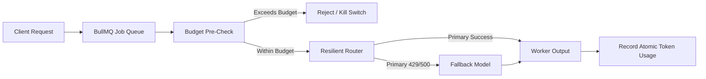

# 🛡️ Resilient AI Worker Kit (Node.js + BullMQ + Redis)

A battle-tested production template for running high-throughput, fault-tolerant AI agent queues with **automatic model failover**, **exponential backoff**, and **token-budget kill switches**.

---

## ⚡ Why This Kit?

Most AI worker queues fail in production because:
1. **Unpredictable Rate Limits:** A single 429 error cascades and crashes active agent tasks.
2. **Runaway Token Bills:** Recursive agents or infinite retry loops run up \$1,000+ bills overnight.
3. **Provider Outages:** When an API provider goes down, all background workers stall.

**The Resilient AI Worker Kit solves this out of the box.**

---

## 🌟 Key Features

- 🔄 **Multi-Provider Failover Router:** Automatically shifts requests from primary models (OpenAI) to fallbacks (Anthropic, Groq, Ollama) on errors or timeouts.
- 🛑 **Redis-Backed Budget Kill Switch:** Real-time token consumption tracking that hard-stops jobs before blowing through daily/monthly spend limits.
- 📬 **BullMQ + Redis Workflows:** Built-in dead-letter queues, jittered exponential backoff retries, and concurrency limits.
- 📊 **Structured Logging:** Ready for Datadog, Grafana Loki, or CloudWatch ingestion.

---

## 🚀 Quick Start

### 1. Installation
```bash
git clone https://github.com/sidsri14/resilient-ai-worker-kit.git
cd resilient-ai-worker-kit
npm install
```

### 2. Environment Setup
```bash
cp .env.example .env
```

### 3. Run Pipeline
```bash
npm run dev
```

---

## 🏗️ Architecture



---

## 📄 License & Commercial Access

[](https://buy.polar.sh/polar_cl_4mrUXvOPjiB4LEIEBsVyJshejMA8oq7XIHPQV163dbE)

- **Community Edition:** Free & Open Source under the MIT License.
- **Enterprise / Production License ($39):** Includes priority queue dashboards, distributed rate-limiting middleware, and direct setup guidance. 👉 [**Instant Checkout on Polar.sh ($39)**](https://buy.polar.sh/polar_cl_4mrUXvOPjiB4LEIEBsVyJshejMA8oq7XIHPQV163dbE)

