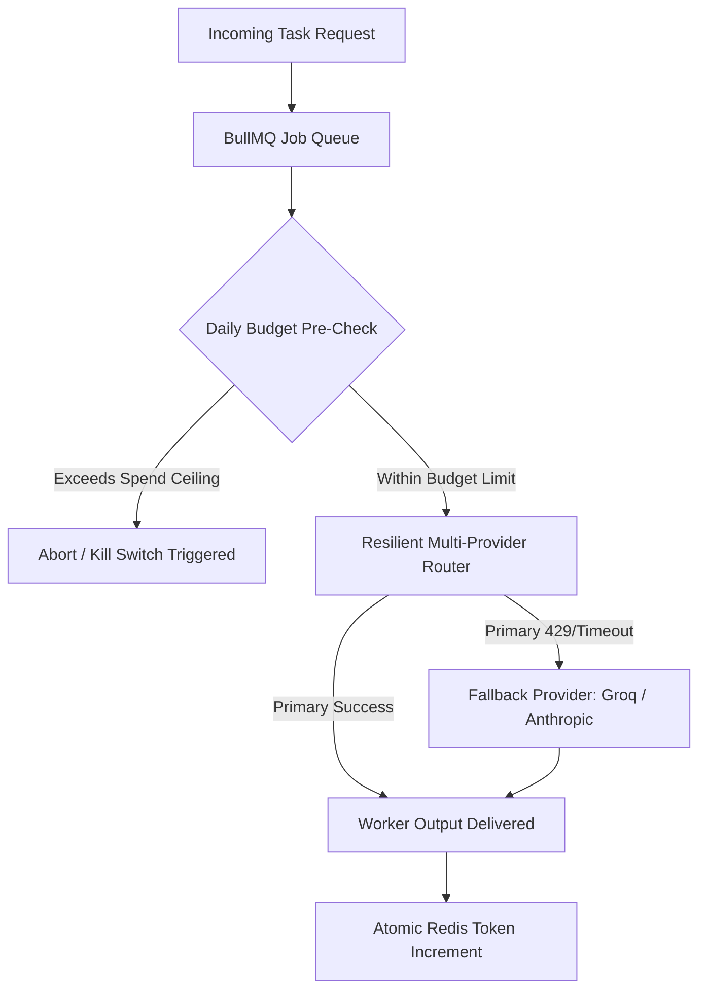

# Preventing Runaway LLM Bills: Building a Resilient AI Worker Queue with Redis, BullMQ, and Model Fallbacks

Building autonomous agents or AI-driven background tasks is exciting—until a bad retry loop or unexpected 429 rate-limit cascades into a \$2,000 API bill overnight.

In production, naive API calls with standard `try/catch` fail for three predictable reasons:
1. **Cascading Rate Limits:** Hitting OpenAI's TPM (Tokens Per Minute) limit causes concurrent workers to retry simultaneously, intensifying rate limits.
2. **Zombie Jobs & Runaway Budgets:** Recursive agent loops consume tokens indefinitely without a global kill switch.
3. **Provider Downtime:** When an upstream provider experiences elevated latencies or 503 outages, the entire application grinds to a halt.

In this tutorial, we will construct a production-ready **AI Worker Queue** in TypeScript using **BullMQ** and **Redis**, featuring:
- **Pre-execution budget kill-switches** (blocking jobs before tokens are spent).
- **Multi-model fallback routing** (automatically routing from OpenAI to Anthropic or Groq on 429/500 errors).
- **Atomic token consumption accounting**.

---

## 🏗️ Architecture Overview



---

## 🛑 Step 1: Redis-Backed Budget Kill Switch

Before an expensive prompt is dispatched to an LLM provider, we pre-calculate estimated tokens and verify against an atomic Redis counter:

```typescript
export class BudgetManager {
  private redis: Redis;
  private keyPrefix = "ai_budget:daily:";

  public async canExecute(estimatedTokens: number): Promise<{ allowed: boolean; currentUsage: number; reason?: string }> {
    const today = new Date().toISOString().split("T")[0];
    const key = `${this.keyPrefix}${today}`;
    const current = parseInt((await this.redis.get(key)) || "0", 10);

    if (current + estimatedTokens > MAX_DAILY_TOKEN_BUDGET) {
      return {
        allowed: false,
        currentUsage: current,
        reason: `Daily token limit breached: ${current} + ${estimatedTokens} > ${MAX_DAILY_TOKEN_BUDGET}`,
      };
    }

    return { allowed: true, currentUsage: current };
  }

  public async recordUsage(tokens: number): Promise<number> {
    const today = new Date().toISOString().split("T")[0];
    const key = `${this.keyPrefix}${today}`;
    const total = await this.redis.incrby(key, tokens);
    await this.redis.expire(key, 172800); // 48h TTL
    return total;
  }
}
```

---

## 🔄 Step 2: Resilient Model Fallback Router

If your primary provider returns a `429 Too Many Requests` or `500 Internal Error`, you shouldn't crash the queue. Instead, fall back to secondary high-availability endpoints seamlessly:

```typescript
export class ResilientModelRouter {
  constructor(private providers: IModelProvider[]) {}

  public async executeWithFailover(req: ModelRequest): Promise<ModelResponse> {
    for (const provider of this.providers) {
      try {
        return await provider.execute(req);
      } catch (err: any) {
        console.warn(`[Failover] Provider ${provider.name} failed: ${err.message}. Trying next fallback...`);
      }
    }
    throw new Error(`All fallback providers exhausted for request [${req.id}]`);
  }
}
```

---

## ⚡ Step 3: BullMQ Worker Orchestration

We bind the budget check and failover router directly into a BullMQ worker process with jittered exponential retries:

```typescript
const worker = new Worker<ModelRequest, ModelResponse>(
  "resilient-ai-jobs",
  async (job: Job<ModelRequest>) => {
    const estimatedTokens = Math.ceil((job.data.prompt.length / 4)) + 500;

    // 1. Budget kill switch check
    const budgetStatus = await budgetManager.canExecute(estimatedTokens);
    if (!budgetStatus.allowed) {
      throw new Error(`[BUDGET_EXCEEDED] ${budgetStatus.reason}`);
    }

    // 2. Execute with automatic provider failover
    const response = await router.executeWithFailover(job.data);

    // 3. Atomically account for actual token consumption
    await budgetManager.recordUsage(response.tokensUsed);

    return response;
  },
  { connection: redisConnection, concurrency: 5 }
);
```

---

## 📦 Open Source Starter & Commercial Edition

The complete, working source code is open-sourced on GitHub:
👉 [**GitHub: sidsri14/resilient-ai-worker-kit**](https://github.com/sidsri14/resilient-ai-worker-kit)

For unrestricted internal production & client deployment rights to the full TypeScript source (`BudgetManager`, `ResilientModelRouter`, BullMQ worker harness, and Vitest verification suite), grab the **Commercial License** via [Polar.sh](https://buy.polar.sh/polar_cl_4mrUXvOPjiB4LEIEBsVyJshejMA8oq7XIHPQV163dbE).
